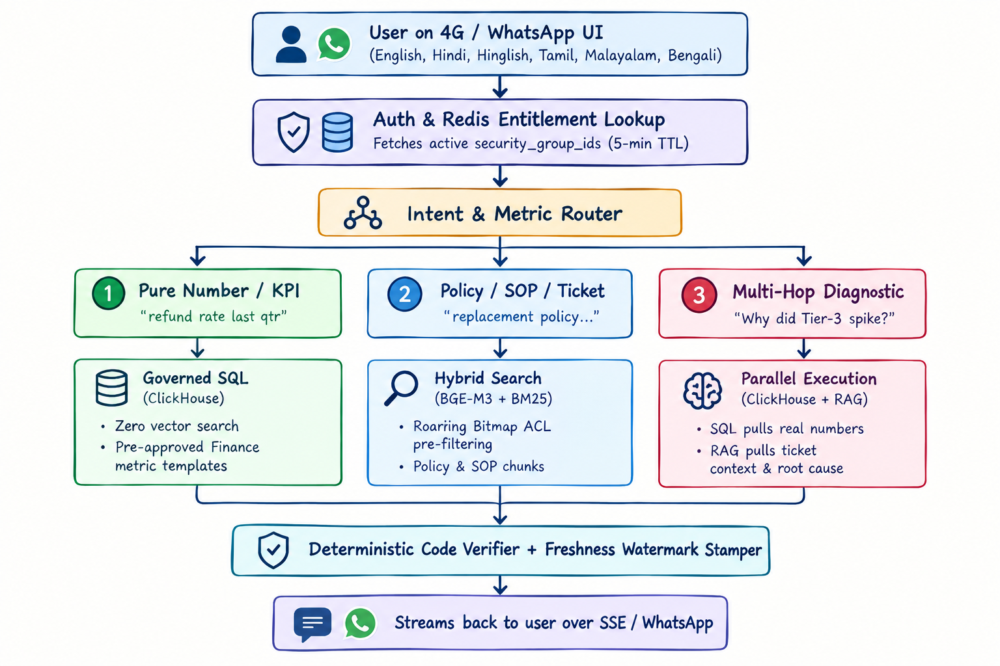

# Bharat Bazaar – Problem 3
## Production Design and Day-9 Incident Review

This project presents a production design for Bharat Bazaar with **1 crore documents**, **10 crore embeddings**, and a monthly budget of **₹40 lakh**. It also describes the response plan for two incidents that occur on Day 9.

This is a design report rather than an application implementation. The repository includes `generate_problem3_pdf.py` to generate a four-page PDF report.

## Part A: Production Design

### 1. Query Routing

Not every query needs RAG. Questions about refund rates and business metrics are sent to governed SQL queries in ClickHouse. Policy, SOP, and ticket queries use hybrid search with BM25 and vector embeddings. Complex questions use both SQL and RAG to combine accurate numbers with supporting context.

### 2. Data and Indexing

Transactional data flows through Debezium and Kafka into ClickHouse. Unstructured documents such as PDFs and tickets are split into chunks and indexed using BGE-M3 embeddings and BM25.

A security-aware search pipeline applies access filters to help prevent users from retrieving unauthorized documents.

### 3. Scale and Cost

The design supports 10 crore embeddings using SQ8 quantization and an HNSW index. Data is distributed across four shards, with additional replicas during sale periods.

The estimated monthly cost is **₹28.25 lakh**, within the **₹40 lakh** budget.

### 4. Security and Freshness

Access permissions are checked before document retrieval. Sensitive information is restricted through role-based access controls and permission-aware caching.

Data freshness is tracked across sources. Deleted documents are removed from search results immediately, while physical cleanup happens later. Responses include the latest available data sync time.

### 5. Testing and Monitoring

The system uses multilingual evaluation tests and automated regression checks. Monitoring covers answer accuracy, latency, data freshness, and access-control failures.

## Part B: Day-9 Incident Review

Two incidents occur on Day 9:

1. The CFO receives an outdated refund rate of **4.1%** from a Metabase PDF, while the updated figure is **6.3%**.
2. A warehouse supervisor receives a summary containing confidential HR information.

### Immediate Response

We disable RAG and clear response caches while keeping the assistant available in SQL-only mode for essential order and shipment queries.

We investigate document access logs and the source of the incorrect financial figure. The relevant security and legal teams are also notified.

### Root Causes and Fixes

The financial error may have occurred because the router selected a stale PDF instead of a governed SQL query.

The HR leak may have resulted from incorrect document permissions or missing access filters in the retrieval pipeline.

Within 24 hours, unstructured documents are blocked from answering financial metric questions, and strict access checks are enforced across both vector and BM25 search.

Over the next six weeks, approved SQL definitions are introduced for business metrics, along with improved document scanning and permission validation.

### Prevention

All business metrics must come from approved SQL sources. If data is missing or outdated, the assistant must clearly state that it cannot determine the answer.

Automated security tests are also added to ensure unauthorized users cannot retrieve confidential documents.

---

**Goal:** Build a reliable and secure AI assistant that provides accurate answers while protecting sensitive company information.
